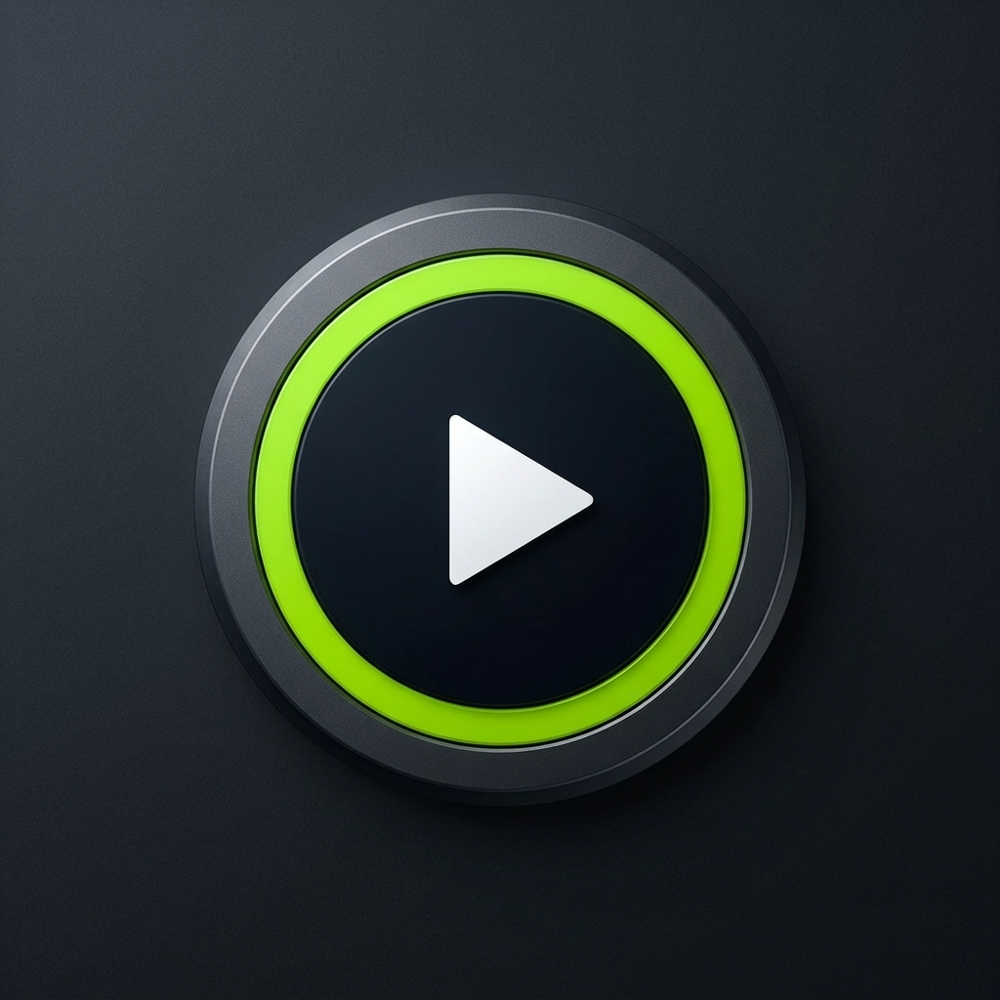
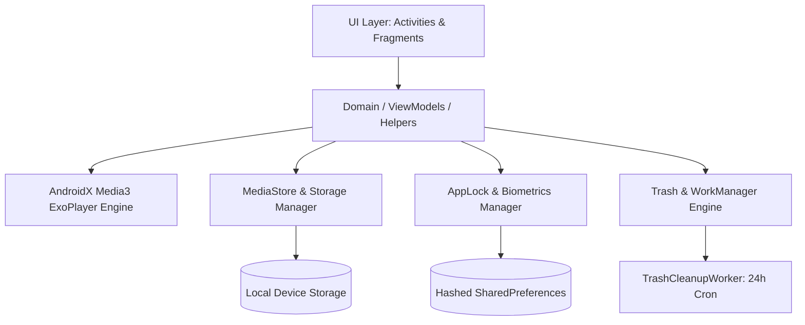

<div align="center">

  

  # ⚡ Zevix Pro — Next-Gen Android Video & Media Player

  [-3DDC84?style=for-the-badge&logo=android&logoColor=white)](https://developer.android.com)
  [](https://www.oracle.com/java/)
  [-blue?style=for-the-badge&logo=googleplay&logoColor=white)](https://developer.android.com/guide/topics/media/media3)
  [](https://m3.material.io)
  [](LICENSE)

  <p align="center">
    <b>A high-performance, privacy-focused media player and video management hub crafted for ultra-smooth 4K HDR playback, biometric security, audio equalization, and intelligent storage management.</b>
  </p>

</div>

---

## 🌟 Key Highlights

### 🎬 Ultra-HD Cinema Player
* **High-Performance Playback Engine**: Powered by **AndroidX Media3 (ExoPlayer 1.3.1)** with hardware decoding acceleration (`MediaCodec`).
* **Universal Format Support**: Plays MKV, MP4, M4V, AVI, MOV, 3GP, FLV, WMV, RMVB, TS, WebM, and more seamlessly.
* **4K & HDR Ready**: Effortlessly renders 4K UHD, FHD, and 10-bit HDR video streams at 60+ fps with adaptive buffer management.
* **Smart Player Gestures**:
  * **Vertical Left Swipe**: Fluid display brightness adjustment.
  * **Vertical Right Swipe**: Precision volume control.
  * **Horizontal Double-Tap & Swipe**: Fast-forward, rewind, and fine-grained seeking.
  * **Aspect Ratio Modes**: Fit to screen, Stretch, 16:9, 4:3, Original, and Center Crop.
  * **Picture-in-Picture (PiP)**: Keep watching in floating mini-player mode while multitasking across other apps.
  * **Background Audio Mode**: Continue listening to video audio in the background with lock screen media controls.

---

### 🔒 Biometric Private Vault & App Lock
* **Private Vault**: Securely move sensitive videos into an encrypted hidden sandbox protected with `.nomedia` indexing shields.
* **Cryptographic Security**: PIN and Pattern locks are protected with **salted SHA-256 cryptographic hashing**; credentials are never stored in plaintext.
* **Biometric Authentication**: Fast fingerprint and facial unlock via **AndroidX BiometricPrompt**.
* **Automatic Security Guards**: Instant re-lock upon backgrounding, task-switching, or screen off.
* **Hardened Sandbox**: Android cloud and ADB backup disabled (`android:allowBackup="false"`) to prevent local or cloud data dumps.

---

### 🗑️ Smart Trash Bin & 30-Day Auto Purge
* **Zero-Trace Permanent Deletion**: Overcomes Android 11–15 Scoped Storage limitations with direct physical truncation and deletion, MediaStore purging, and system gallery cache scrubbers.
* **Accidental Delete Protection**: Soft-delete videos to Trash with a 30-day recovery window.
* **Automated Daily Cleanup**: Background worker scheduled via **AndroidX WorkManager** (`TrashCleanupWorker`) running daily to permanently erase files exceeding the 30-day retention policy without requiring manual app interaction.

---

### 🧹 Storage Cleaner
* **Watched Video Detection**: Identifies fully or partially viewed videos to quickly reclaim storage.
* **Large File Finder**: Quickly sorts and highlights videos taking up hundreds of megabytes or gigabytes.
* **Duplicate Video Cleaner**: Groups identical videos across disparate directories for one-tap batch cleaning.

---

### 🎵 Hi-Res Audio Player & Equalizer
* **Dedicated Music Explorer**: Organizes tracks by Songs, Artists, Albums, and Custom Playlists.
* **Integrated 10-Band Graphic Equalizer**: Pre-tuned genre presets (Rock, Pop, Jazz, Classical, Flat) alongside custom parametric user profiles.
* **Audio FX Engine**: Built-in **Bass Boost** and **3D Virtualizer** audio processing.
* **Foreground Media Playback Service**: Dedicated audio service with notification action triggers and lock screen album art integration.

---

## 🏗️ Architecture & Technology Stack



| Layer | Technologies |
|---|---|
| **Core Architecture** | MVVM, ViewBinding, Android Architecture Components |
| **Media Engine** | AndroidX Media3 (ExoPlayer 1.3.1), MediaCodec hardware decoding |
| **Image & Thumbnail Engine** | Glide 4.16.0 with custom memory & disk caching |
| **Background Processing** | AndroidX WorkManager 2.9.0 with battery-aware scheduling |
| **Security & Privacy** | AndroidX Biometric 1.1.0, SHA-256 Cryptographic Hash Engine |
| **Animations** | Airbnb Lottie 6.4.0 (Custom handwriting vector typography) |
| **UI Components** | Google Material Design 3, ViewPager2, SwipeRefreshLayout |

---

## 🛡️ Security & Privacy Engineering

* **Zero Plaintext Credentials**: All user passwords, PINs, and patterns are digested through **SHA-256** before persistence.
* **Strict Component Isolation**: Every internal activity and service explicitly declares `android:exported="false"` to prevent unauthorized external intent interception.
* **Backup Hardening**: `android:allowBackup="false"` is enforced in `AndroidManifest.xml` to prevent extraction via physical `adb backup` vectors.
* **Isolated Private Storage**: Vault files are stored in private app storage with `.nomedia` markers, isolating them from third-party galleries and untrusted scanners.

---

## 🚀 Getting Started

### Prerequisites
* **Android Studio**: Iguana (2023.2.1) or newer
* **Java Development Kit (JDK)**: OpenJDK 17
* **Android SDK**: Build Tools 34.0.0 (API Level 34 target, minimum API 24)

### Building from Source

1. **Clone the repository**:
   ```bash
   git clone https://github.com/JoyalJose54/ZevixPro.git
   cd ZevixPro
   ```

2. **Build Debug APK**:
   ```bash
   ./gradlew assembleDebug
   ```

3. **Install directly to a connected USB or Wi-Fi device**:
   ```bash
   adb install -r app/build/outputs/apk/debug/app-debug.apk
   ```

4. **Launch Zevix Pro**:
   ```bash
   adb shell am start -n com.app.zevix/.ui.SplashActivity
   ```

---

## 📱 Permissions Overview

| Permission | Purpose |
|---|---|
| `MANAGE_EXTERNAL_STORAGE` / `READ_MEDIA_VIDEO` | Accessing, organizing, moving to Trash, and permanently deleting video files across storage |
| `READ_MEDIA_AUDIO` | Playing local audio tracks in the Music Explorer |
| `USE_BIOMETRIC` | Fingerprint & biometric authentication for Private Vault and App Lock |
| `FOREGROUND_SERVICE` & `FOREGROUND_SERVICE_MEDIA_PLAYBACK` | Uninterrupted background music playback and notification controls |
| `WAKE_LOCK` | Keeping the display active during video playback |

---

## 📄 License

This project is licensed under the **MIT License** — see the [LICENSE](LICENSE) file for details.

<div align="center">
  <sub>Engineered with precision for Android by Joyal Jose J.</sub>
</div>
